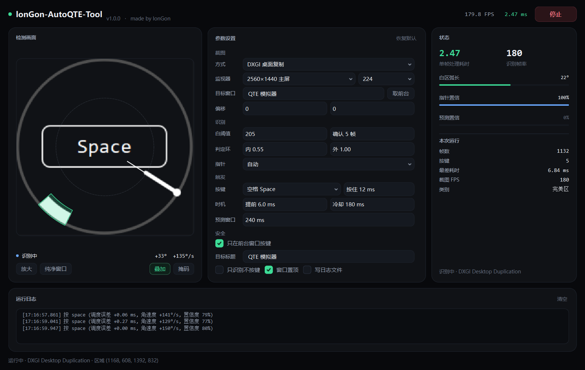

# lonGon-AutoQTE-Tool

> 给自己的单机游戏做的本地自动 QTE 工具。纯视觉识别、不读内存、不注入进程。
> **made by lonGon**



## 下载

到 [Releases](../../releases) 下载 `lonGon-AutoQTE-Tool-v1.0.0-win64.zip`，
解压到任意目录（别放 `C:\Program Files` 这种需要管理员权限的地方），双击
`lonGon-AutoQTE-Tool.exe` 就能用。

不需要装 Python，不需要联网，不需要管理员权限，也不写注册表。

> 程序没有代码签名，Windows 第一次打开可能弹「已保护你的电脑」，
> 点「更多信息 → 仍要运行」即可。发行包附了 SHA256，可以核对。

---

## 先说清楚适用范围

这个工具是给**你自己做的单机游戏**（以及你发给试玩玩家的版本）用的。
它做的事只有三件：截屏幕中心那一小块 → 认出白色完美区和旋转指针 → 到点按一下你设置的键。

它**不做**、也不会加入这些东西：

- 不读写游戏内存、不注入 DLL、不改游戏文件；
- 不做任何反作弊对抗/规避（包括给商业联机游戏用的那些手段）；
- 不联网、没有卡密、没有时间戳校验、不收集任何信息。

如果你要拿去在**带反作弊的联机游戏**里用，那不在这个工具的适用范围里，也别来找我要那部分功能。

---

## 它解决了什么

| 痛点 | 做法 |
| --- | --- |
| 原来的工具高压下截图/推理要 5ms 以上 | 只截屏幕中心 224×224，DXGI 桌面复制直接抓这一小块；识别用纯 numpy 的极坐标统计，不跑神经网络。实测 **截图 1.6ms + 推理 0.7ms ≈ 2.3ms** |
| 连打 50 次后指针变快，原来的工具开始打空 | 每帧重新做一次加权最小二乘，估当前角速度，2~3 帧内就跟上新速度；预测的是"指针到达白区中心的时刻"，不是"看见白区才按" |
| 不同机器/画质下延迟不一样 | 「提前量」可调（0~40ms），默认 6ms；按 F8 随时开关 |
| C 盘被截图缓存撑爆 | 全程只在内存里转，一张图都不落盘；日志默认不写文件；配置就是 exe 旁边一个 json |
| 想边玩边录 | 自带「纯净预览窗口」，无边框置顶，OBS 直接窗口采集；也可以反过来用 OBS 投影窗口当输入源 |

---

## 快速开始

1. 双击 `lonGon-AutoQTE-Tool.exe`。
2. **先别急着启动**。把你的游戏开到 QTE 会出现的那一步，让 QTE 停在屏幕上。
3. 点左下「检测画面」下面的 **叠加** 和 **掩码**，看画面里：
   - 绿色弧 = 识别到的白色完美区（应该正好盖住你游戏里的白条）；
   - 白线 + 白点 = 识别到的指针方向；
   - 绿色小圆圈 = 预测的落点（应该在白区中间）。
4. 对不上就调「参数设置 → 识别」里的三项（见下面的调参表）。
5. 点「目标窗口 → 取前台」，把目标锁定成你的游戏窗口（这样只有游戏在前台时才会按键）。
6. 按键默认是 `空格`，改成你游戏里 QTE 用的键。
7. 点右上 **启动**，或按 **F8**。按 **F9** 是紧急停止。

> 第一次用建议先勾上「只识别不按键」，跑一局看看「状态」面板里的
> 类别是不是稳定显示「完美区」、预测置信度是不是经常在 50% 以上，再取消勾选正式用。

---

## 界面

```
┌ lonGon-AutoQTE-Tool   v1.0.0 · made by lonGon        — FPS   — ms   [启动] ┐
├────────────────┬──────────────────┬──────────────────┤
│  检测画面       │  参数设置         │  状态             │
│  （正方形实时）  │  截图 / 识别      │  单帧耗时 / 帧率   │
│                │  触发 / 安全      │  白区·指针·预测    │
│  ● 状态  角度   │                  │  本次运行          │
│  [放大][纯净]   │                  │                  │
├────────────────┴──────────────────┴──────────────────┤
│  运行日志                                             │
└───────────────────────────────────────────────────────┘
```

- **检测画面**：正方形，不会随窗口拉成奇怪的比例。点一下弹出放大窗；「纯净窗口」是不带叠加层的版本，专门给 OBS 采集；「叠加 / 掩码」是调试用的开关。
- **状态**：左边两个大数字就是 `单帧耗时`（截图+推理）和 `识别帧率`，绿色表示 ≤4ms；下面三条是白区弧长、指针置信、预测置信。
- **参数**：右上角有「恢复默认」，调乱了可以一键回到初始值。
- **滚轮不会误改数值**：数值框必须先点一下拿到焦点，滚轮才生效；平时滚轮划过只会滚动页面。

> 界面里所有数值框都做了滚轮保护：以前鼠标划过就改数字的情况不会再出现。

---

## 参数怎么调

| 参数 | 默认 | 什么时候改 |
| --- | --- | --- |
| 截图方式 | DXGI 桌面复制 | 独占全屏抓不到时换「GDI 兼容模式」；想从 OBS 投影窗口抓就选「窗口 / OBS 投影」 |
| 尺寸 | 224×224 | 游戏里的 QTE 明显比 224 大就换 320，比 224 小就保持 224（宁可框大一点） |
| 偏移 | 0, 0 | QTE 不在屏幕正中时，手动挪（比如往上 -40） |
| 白阈值 | 205 | 完美区不够白、识别不到 → 调低（190）；把别的高光错认成白区 → 调高（225） |
| 判定环 内/外 | 0.55 / 1.00 | 只认圆环那一圈。游戏里指针很短 → 内径调大（0.7）；QTE 圆环没那么大 → 外径调小（0.95） |
| 白区确认 | 5 帧 | 白区闪一下就消失 → 调小；把不动的白字/图标误认成白区 → 调大 |
| 指针来源 | 自动 | 指针是白色就用自动；指针是红色/彩色 → 选「只用运动」 |
| 按键 | 空格 | 你游戏里 QTE 的键（支持鼠标左/右键） |
| 提前量 | 6ms | **最关键的微调**：总是偏早（按在白区前半段）→ 调大；总是偏晚（按在白区后半段/打空）→ 调小 |
| 冷却 | 180ms | 一次 QTE 被按了两次 → 调大 |
| 按住 | 12ms | 游戏要求长按才认 → 调大 |
| 预测时域 | 240ms | 指针很慢、白区很远时不用改；指针很快时可以调小到 150ms 更保守 |
| 只在前台按键 | 开 | 建议一直开，配合「目标标题」 |
| 目标标题 | 空 | 填游戏窗口标题的一部分（比如游戏名），只有它在前台时才动手 |
| 只识别不按键 | 关 | 调试/压力测试用，只统计不按键 |

### 怎么判断"提前量"对不对

用模拟器（`tools\...` 见下）或者直接看日志：

```
[16:48:33.619] 按 space  (调度误差 +0.13 ms, 角速度 +154°/s, 置信度 82%)
```

- `调度误差` 是"实际按下"和"计划按下"的差，正常在 ±0.3ms 内，这一项不用管；
- 真正要调的是游戏侧的响应延迟，也就是「提前量」。判断方法：把白区调宽一点（简单模式），
  看落点是在白区中心、前半段还是后半段，再以 0.5ms 为步长微调。

---

## 它是怎么认的（想自己改代码可以看这段）

1. **只截中心**：DXGI Desktop Duplication 抓屏幕中心 `尺寸×尺寸` 的区域，没有新帧时立刻返回，
   不空转 CPU。
2. **只看环**：把这一小块按极坐标展开，只保留半径 `内径~外径` 的环带。中间那个 `Space`
   键帽提示、背景、特效全都不参与判定。
3. **白区 = 不动的白**：对最近 K 帧做**时序 AND**。指针在动，几帧就被抹掉；白区不动，留了下来。
   所以不需要训练模型，也不需要事先知道白区在哪个角度 —— 每局它自己标定。
   白区的弧**只在外圈 30%** 里统计，避免把中间的静态键帽当成白区。
4. **指针 = 白 - 静态**，用 `Σcosθ / Σsinθ` 求方向（O(N)，没有连通域和轮廓查找）。
   指针不是白色时，退化成帧差找运动块。
5. **预测**：对最近 N 帧的 (时间, 角度) 做加权最小二乘，得到 ω；算出指针到达白区中心的时刻，
   减去「提前量」，用自旋等待卡在 ±0.1ms 内按下。
   - 指针压到白区上时，白色轮廓会被并进白区、质心往回偏，所以**这时候停止采样**，纯外推；
   - 角度突然跳变 >60° 认为是新一局，清空白区历史重来。

单帧成本：224×224 下 `update()` 约 **0.20ms**。

---

## 性能实测（这台机器：R7 7435H + RTX 4060 Laptop，2560×1440@180Hz）

| 指标 | 数值 |
| --- | --- |
| 截图耗时 | 1.55 ~ 1.60 ms |
| 推理耗时 | 0.50 ~ 0.71 ms |
| 合计 | **2.1 ~ 2.3 ms** |
| 处理帧率 | 跟随游戏帧率（实测 179.8 fps） |
| 端到端命中 | 模拟器 150→297°/s 变速，24/24 全中，落点误差 0.03°~2.3° |

> 说明：`截图耗时` 是"抓这一帧"本身花的时间，`推理耗时` 是识别+预测的时间。
> 真正决定打不打得中的是预测精度，不是这两个数——因为工具预测的是"未来某一刻"，
> 处理慢 1ms 只是让它多看 1ms 之前的一帧。

---

## OBS 怎么配合

两种用法，都行：

1. **工具 → OBS**：点「纯净窗口」，会弹出一个无边框置顶的小窗（只有画面、没有叠加层），
   在 OBS 里加「窗口采集」选它即可。
2. **OBS → 工具**：OBS 里对游戏做「窗口采集 / 游戏采集」，然后右键 → 「全屏投影（预览）」，
   把截图方式改成「窗口 / OBS 投影」，目标窗口填 `OBS` 之类的关键字。
   适合游戏是独占全屏、DXGI 抓不到的情况（延迟会比直接 DXGI 高一点）。

---

## 模拟器（验证/调参用）

不用开游戏就能验证工具是不是真的能打中：

```powershell
.\.venv\Scripts\python.exe -m longon_qte.sim.qte_sim --speed 150 --zone 24 --accel-after 50
```

- 窗口居中，中间 224×224 就是截图区域，四角的数字在截图框外，不会干扰识别；
- 按空格判定，会打印 `角度 / 白区 / 误差`；
- `--accel-after 50` 表示打中 50 次后指针提速到 1.65 倍，用来复现"连打变快"。

跑通的样子：误差基本在 ±1° 以内，提速后也不会掉。

---

## 从源码构建

```powershell
# 1. 建环境（全部放 D 盘，不污染 C 盘）
py -3.13 -m venv .venv
.\.venv\Scripts\python.exe -m pip install --no-cache-dir numpy bettercam mss PySide6 pyinstaller

# 2. 生成图标
.\.venv\Scripts\python.exe tools\gen_icon.py

# 3. 打包（onedir，noconsole）
.\.venv\Scripts\python.exe -m PyInstaller --noconfirm --clean lonGon-AutoQTE-Tool.spec
```

产物在 `dist\lonGon-AutoQTE-Tool\`（exe 与 `_internal` 同级）。
`build.ps1` 会顺手把它复制到 `lonGon-AutoQTE-Tool\` 并打印体积，这个文件夹就是发人用的。

> 用 onedir 而不是 onefile，是因为 onefile 每次启动都要往 `%TEMP%` 解压几十 MB，
> 既慢又会在 C 盘留东西。

---

## 目录

```
.
├─ lonGon-AutoQTE-Tool\           ← 打包出来的发布文件夹（不进 git）
│  ├─ lonGon-AutoQTE-Tool.exe     ← 双击它
│  ├─ _internal\                  ← 运行时文件，别删
│  ├─ 使用说明.txt
│  └─ lonGon-AutoQTE-Tool.json    ← 首次运行后生成
├─ src\longon_qte\                ← 源码
│  ├─ app.py                      ← 入口
│  ├─ main_window.py              ← 界面
│  ├─ engine.py                   ← 抓帧→识别→预测→按键 的线程
│  ├─ capture.py                  ← DXGI / GDI / 窗口 截图
│  ├─ detector.py                 ← 白区/指针识别
│  ├─ predictor.py                ← 角速度与落点预测
│  ├─ injector.py                 ← SendInput
│  ├─ config.py  theme.py  widgets.py  winutil.py
│  └─ sim\qte_sim.py              ← 模拟器
├─ tests\                         ← 离线 / 端到端测试脚本
├─ tools\gen_icon.py              ← 生成图标与界面小图标
├─ docs\screenshot.png
├─ packaging\                     ← 打包入口 + 使用说明
├─ build.ps1
├─ lonGon-AutoQTE-Tool.spec
└─ LICENSE
```

---

## 常见问题

**Q：启动后状态行一直是「未检测到画面」**
A：截图区域里没有东西。检查：游戏是不是全屏在最前？「尺寸」是不是比游戏里的 QTE 大太多？
换个截图方式试试；或者把「掩码」打开看看工具到底抓到了什么。

**Q：白区识别到了，但从来不按**
A：`预测置信` 上不去。多半是指针方向没测准——看「指针置信」是不是很低；
是的话把「指针来源」换成「只用运动」，或者把「判定环」的内径调大，把中心的键帽排除掉。

**Q：按得太早 / 太晚**
A：调「提前量」，0.5ms 一步。太早（落在白区前半段）→ 加；太晚 → 减。

**Q：连打几十次之后开始打空**
A：正常情况下不会——角速度每帧重估。如果确实出现，把「预测窗口」调小到 150ms，
并把「白区确认」调小到 4 帧，让白区跟得更快。

**Q：能不能不装 Python 直接用**
A：可以，Releases 里的 zip 就是打包好的，目标机器不需要 Python。

**Q：会不会写 C 盘**
A：不会。截图只在内存里；默认不写日志；配置在 exe 旁边。只有你勾了「写日志文件」，
才会在 exe 目录写一个上限 512KB 的 `running.log`。

**Q：滚轮划过数值框会改数值吗**
A：不会。数值框要先点一下拿到焦点，滚轮才生效；平时滚轮划过只滚动页面。

---

## 许可证

[MIT](LICENSE) © 2026 lonGon

---

*lonGon-AutoQTE-Tool v1.0.0 — made by lonGon*
